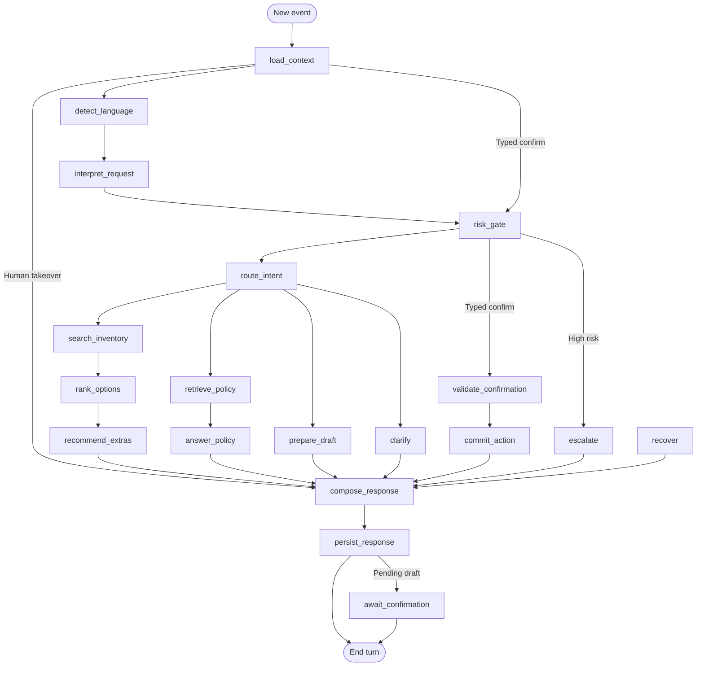

# Architecture

## Runtime

Four Compose services: Next.js web, async FastAPI API, PostgreSQL 17/pgvector and Redis. Assets use a local mounted directory. OpenAI (`gpt-4o-mini`, `text-embedding-3-small`) and CBAR are the application external dependencies. Dependency installation and tokenizer assets are downloaded at image-build time.

Python 3.12 containers satisfy the Python 3.11+ baseline. FastAPI uses asynchronous handlers and Pydantic v2 schemas; Next.js renders the customer and operator interfaces. Routes authenticate and validate; services own rules/transactions; provider adapters own external calls. SQLAlchemy 2 Async/asyncpg manages business data. A separate psycopg pool backs AsyncPostgresSaver in `agent_state`.

## Workflow

`load_context → detect_language → interpret_request → risk_gate → route_intent` branches into clarification, live search/ranking/upsells, cited policy retrieval/answering, or draft preparation. Typed confirmation bypasses interpretation and enters `validate_confirmation → commit_action`. `compose_response → persist_response` finishes a turn; a pending draft passes through `await_confirmation → END`. Exceptions enter `recover`. Handoff routes into `escalate` and pauses automation.

Each accepted event is stored before AI work. A conversation advisory lock serializes actions without holding a business transaction across provider calls. The graph checkpoints every stage. Authoritative prices, drafts, versions and allocations are always read from business tables, not trusted from graph state. Booking side effects are idempotent against run IDs.

Natural-language search stores `sort_by` separately from eligibility filters. Ordinary repeated searches ignore display history and return stable ordering. Explicit requests for other options exclude vehicles already shown for the same normalized filter scope; when that pool is exhausted the assistant explains it instead of repeating cars or loosening requirements. An ordering follow-up preserves dates, pickup branch, seats and stated budgets. Incomplete budget details require clarification, and a complete budget is never automatically relaxed. Space ordering uses recorded seat counts and luggage-space features, not inferred dimensions or brand reputation.

## Data and booking integrity

The source of the full application schema is `backend/app/models`; the initial schema is frozen in the migration. Core groups: identity/sessions/idempotency; conversations/chat_logs/agent_runs; branches/vehicles/photos/extras/allocations; rental_policies/rate_plans/pricing_rules/fx_rates/approved_adjustments; quotes/items/drafts/reservations/versions/grants; policy_documents/chunks; support cases/audit/conversion events.

Vehicle windows use `[pickup, return)`. A GiST exclusion constraint disallows overlapping active allocations. Expired holds are released lazily under the vehicle lock. Extra allocations enforce peak concurrent stock under extra-row locks. Modification holds cover incremental windows/quantities, preserving the original allocation.

Quoted money uses integer AZN qəpiks, with Decimal for percentages and FX. Price snapshots are signed server-side and immutable under application credentials. A valid quote retains its price when the operator later publishes another rate version. Confirmation validates eligibility and stock independently. Contracts are versioned; cancellation releases stock but retains the reservation.

## Policy and trust boundaries

Policies are reviewed bilingual Markdown. Chunks use 1536-dimensional pgvector embeddings, language/effective-date filters and keyword/vector reciprocal-rank fusion. Answers cite returned source IDs and abstain without support. No user transcripts are embedded.

Provider requests never expose the database or reservation tools. Only predefined UI events can request commits. Customer/document content is untrusted. React renders raw chat as escaped text. Catalog paths and uploads are controlled. Sessions are opaque HttpOnly cookies; state-changing actions require a session-bound CSRF header and approved Origin.

## Retention

Raw histories and contact fields are not anonymized or redacted. Twelve-month inactivity deadlines create manual review eligibility. An explicit admin purge removes logs, derived draft contact copies and graph checkpoint data in PostgreSQL, preserving contractual reservations and their audit. The deletion audit contains counts and administrator justification, not removed transcript copies. No scheduled cleanup, backup or export task exists.

All infrastructure remains locally hosted. Database-superuser and host access are trusted, and no off-host copy protects against storage loss.

## Complete target directory tree

The admin console uses an explicit allowlist in `admin_metadata.py` to describe all 28 tables and 283 fields, including a write-only password input. `schemas/catalog.py` validates editable fields; `services/admin_data.py` enforces relationship, allocation and account guards. The paginated `/admin/data` APIs and field-based `AdminDataBrowser` share this metadata. Protected transactional records use their booking, publication or manual retention workflows. Catalog mutations and data reads are audited; credentials and internal search vectors never appear in admin responses.

Dependency directories and compiler caches are omitted. `.env` and credential files are generated locally and ignored by Git.

```text
rental-car-ai-assistant/
├── .secrets/
│   ├── .gitkeep
│   ├── app_database_password
│   ├── graph_database_password
│   ├── openai_api_key
│   ├── postgres_password
│   ├── quote_signing_key
│   └── redis_password
├── backend/
│   ├── app/
│   │   ├── agents/
│   │   │   ├── __init__.py
│   │   │   ├── graph.py
│   │   │   ├── nodes.py
│   │   │   ├── prompts.py
│   │   │   └── state.py
│   │   ├── api/
│   │   │   ├── routes/
│   │   │   │   ├── __init__.py
│   │   │   │   ├── admin.py
│   │   │   │   ├── admin_data.py
│   │   │   │   ├── auth.py
│   │   │   │   ├── bookings.py
│   │   │   │   └── conversations.py
│   │   │   ├── __init__.py
│   │   │   └── dependencies.py
│   │   ├── core/
│   │   │   ├── __init__.py
│   │   │   ├── config.py
│   │   │   ├── errors.py
│   │   │   ├── rate_limits.py
│   │   │   └── security.py
│   │   ├── db/
│   │   │   ├── __init__.py
│   │   │   ├── base.py
│   │   │   ├── checkpoints.py
│   │   │   ├── locks.py
│   │   │   └── session.py
│   │   ├── models/
│   │   │   ├── __init__.py
│   │   │   ├── audit.py
│   │   │   ├── bookings.py
│   │   │   ├── conversations.py
│   │   │   ├── fleet.py
│   │   │   ├── identity.py
│   │   │   ├── policies.py
│   │   │   ├── pricing.py
│   │   │   └── support.py
│   │   ├── providers/
│   │   │   ├── __init__.py
│   │   │   ├── cbar.py
│   │   │   ├── filesystem.py
│   │   │   ├── in_app_notifications.py
│   │   │   ├── interfaces.py
│   │   │   ├── openai_chat.py
│   │   │   └── openai_embeddings.py
│   │   ├── repositories/
│   │   │   └── __init__.py
│   │   ├── schemas/
│   │   │   ├── __init__.py
│   │   │   ├── admin.py
│   │   │   ├── catalog.py
│   │   │   ├── bookings.py
│   │   │   ├── chat.py
│   │   │   ├── intent.py
│   │   │   ├── inventory.py
│   │   │   └── money.py
│   │   ├── services/
│   │   │   ├── admin_data.py
│   │   │   ├── admin_metadata.py
│   │   │   ├── __init__.py
│   │   │   ├── audit.py
│   │   │   ├── conversations.py
│   │   │   ├── drafts.py
│   │   │   ├── escalations.py
│   │   │   ├── fx.py
│   │   │   ├── inventory.py
│   │   │   ├── policies.py
│   │   │   ├── pricing.py
│   │   │   ├── reservations.py
│   │   │   └── upsells.py
│   │   ├── __init__.py
│   │   └── main.py
│   ├── migrations/
│   │   ├── versions/
│   │   │   └── 0001_initial.py
│   │   ├── env.py
│   │   └── initial_schema.json
│   ├── scripts/
│   │   ├── bootstrap_admin.py
│   │   ├── import_catalog.py
│   │   ├── seed_demo.py
│   │   └── initialize_checkpoints.py
│   ├── .dockerignore
│   ├── Dockerfile
│   ├── alembic.ini
│   ├── openapi.json
│   ├── pyproject.toml
│   └── uv.lock
├── data/
│   ├── assets/
│   │   ├── policies/
│   │   │   ├── az/
│   │   │   │   └── .gitkeep
│   │   │   └── en/
│   │   │       └── .gitkeep
│   │   └── vehicles/
│   │       └── .gitkeep
│   └── catalog/
│       ├── extras.example.json
│       └── fleet.example.json
├── docker/
│   └── postgres/
│       └── init.sh
├── docs/
│   ├── architecture.md
│   ├── execution-plan.md
│   └── operations.md
├── frontend/
│   ├── messages/
│   │   ├── az.json
│   │   └── en.json
│   ├── public/
│   │   └── vehicle-placeholder.svg
│   ├── src/
│   │   ├── app/
│   │   │   ├── admin/
│   │   │   │   └── [[...section]]/
│   │   │   │       └── page.tsx
│   │   │   ├── api/
│   │   │   │   └── [...path]/
│   │   │   │       └── route.ts
│   │   │   ├── policies/
│   │   │   │   └── [id]/
│   │   │   │       └── page.tsx
│   │   │   ├── reservations/
│   │   │   │   ├── [id]/
│   │   │   │   │   └── page.tsx
│   │   │   │   └── page.tsx
│   │   │   ├── globals.css
│   │   │   ├── layout.tsx
│   │   │   └── page.tsx
│   │   ├── components/
│   │   │   ├── AdminConsole.tsx
│   │   │   ├── AdminDataBrowser.tsx
│   │   │   └── CardRenderer.tsx
│   │   ├── hooks/
│   │   │   └── useConversation.ts
│   │   ├── lib/
│   │   │   ├── api.ts
│   │   │   ├── dates.ts
│   │   │   └── query-client.tsx
│   │   └── types/
│   │       ├── api.generated.ts
│   │       └── chat.ts
│   ├── .dockerignore
│   ├── Dockerfile
│   ├── next-env.d.ts
│   ├── next.config.ts
│   ├── package.json
│   ├── pnpm-lock.yaml
│   ├── postcss.config.mjs
│   └── tsconfig.json
├── scripts/
│   └── setup_local.py
├── .dockerignore
├── .env
├── .env.example
├── .gitignore
├── README.md
└── compose.yaml
```

## PostgreSQL tables and columns

Every application table has `id UUID PRIMARY KEY` and `created_at TIMESTAMPTZ`. `?` marks a nullable column below. Foreign-key relationships are defined in the models and frozen migration. All contractual amounts ending in `_qepik` use integer AZN minor units.

| Table | Core columns, excluding common ID/timestamp |
|---|---|
| `admin_users` | `email` VARCHAR(255), `password_hash` TEXT, `role` VARCHAR(20), `active` BOOLEAN |
| `agent_runs` | `conversation_id` CHAR(32), `client_event_id` CHAR(32), `input_log_id` CHAR(32), `event_kind` VARCHAR(40), `status` VARCHAR(20), `checkpoint_id` TEXT?, `response_log_id` CHAR(32)?, `input_tokens` INTEGER, `output_tokens` INTEGER, `error_code` VARCHAR(80)?, `started_at` TIMESTAMPTZ, `finished_at` TIMESTAMPTZ? |
| `approved_adjustments` | `escalation_case_id` CHAR(32), `conversation_id` CHAR(32), `reservation_id` CHAR(32)?, `amount_qepik` BIGINT, `reason` TEXT, `approved_by` CHAR(32), `expires_at` TIMESTAMPTZ, `consumed_by_version_id` CHAR(32)? |
| `audit_events` | `actor_type` VARCHAR(20), `actor_id` CHAR(32)?, `action` VARCHAR(80), `entity_type` VARCHAR(80), `entity_id` CHAR(32), `request_id` TEXT, `before_snapshot` JSONB?, `after_snapshot` JSONB?, `reason` TEXT? |
| `booking_access_grants` | `session_id` CHAR(32), `reservation_id` CHAR(32), `permissions` JSONB, `revoked_at` TIMESTAMPTZ? |
| `booking_drafts` | `conversation_id` CHAR(32), `quote_id` CHAR(32), `action_kind` VARCHAR(20), `reservation_id` CHAR(32)?, `base_reservation_version` INTEGER?, `proposal` JSONB, `status` VARCHAR(20), `expires_at` TIMESTAMPTZ, `committed_version_id` CHAR(32)?, `operation_key` TEXT |
| `branches` | `name_az` TEXT, `name_en` TEXT, `city` TEXT, `address` TEXT, `country_code` VARCHAR(2), `opening_hours` JSONB, `active` BOOLEAN |
| `chat_logs` | `conversation_id` CHAR(32), `sequence` BIGINT, `client_event_id` CHAR(32)?, `role` VARCHAR(20), `raw_content` TEXT, `payload` JSONB, `agent_run_id` CHAR(32)? |
| `conversations` | `session_id` CHAR(32), `language` VARCHAR(2), `status` VARCHAR(20), `contact_name` TEXT?, `contact_email` TEXT?, `contact_phone` TEXT?, `session_state` JSONB, `state_version` INTEGER, `active_draft_id` CHAR(32)?, `last_activity_at` TIMESTAMPTZ, `retention_due_at` TIMESTAMPTZ |
| `conversion_events` | `conversation_id` CHAR(32)?, `event_name` VARCHAR(60), `attributes` JSONB |
| `escalation_cases` | `conversation_id` CHAR(32), `reservation_id` CHAR(32)?, `reason_code` VARCHAR(60), `summary` TEXT, `source_log_ids` JSONB, `status` VARCHAR(20), `assigned_admin_id` CHAR(32)?, `resolution` JSONB?, `opened_at` TIMESTAMPTZ, `resolved_at` TIMESTAMPTZ? |
| `extra_allocations` | `extra_id` CHAR(32), `period` TSTZRANGE, `quantity` INTEGER, `status` VARCHAR(20), `draft_id` CHAR(32)?, `reservation_id` CHAR(32)?, `expires_at` TIMESTAMPTZ? |
| `extras` | `code` VARCHAR(40), `kind` VARCHAR(30), `name_az` TEXT, `name_en` TEXT, `description_az` TEXT, `description_en` TEXT, `price_qepik` BIGINT, `billing_unit` VARCHAR(20), `stock_total` INTEGER?, `eligibility_rules` JSONB, `active` BOOLEAN |
| `fx_rates` | `currency_code` VARCHAR(3), `effective_date` DATE, `azn_per_unit` NUMERIC(18, 8), `source_url` TEXT, `fetched_at` TIMESTAMPTZ |
| `idempotency_records` | `session_id` CHAR(32), `key` VARCHAR(200), `operation` VARCHAR(80), `request_hash` VARCHAR(64), `result_reference` JSONB |
| `policy_chunks` | `document_id` CHAR(32), `chunk_index` INTEGER, `content` TEXT, `section_reference` TEXT, `search_vector` TSVECTOR, `embedding` VECTOR(1536), `embedding_model` TEXT, `content_hash` VARCHAR(64) |
| `policy_documents` | `document_key` TEXT, `topic` TEXT, `language` VARCHAR(2), `version` INTEGER, `branch_id` CHAR(32)?, `source_asset_key` TEXT, `full_text` TEXT, `content_hash` VARCHAR(64), `effective_from` TIMESTAMPTZ, `effective_until` TIMESTAMPTZ?, `status` VARCHAR(20), `reviewed_by` CHAR(32)?, `reviewed_at` TIMESTAMPTZ? |
| `pricing_rules` | `rate_plan_id` CHAR(32), `kind` VARCHAR(30), `amount_qepik` BIGINT, `effective_dates` DATERANGE?, `conditions` JSONB |
| `quote_items` | `quote_id` CHAR(32), `code` VARCHAR(60), `label_az` TEXT, `label_en` TEXT, `quantity` INTEGER, `unit_amount_qepik` BIGINT, `line_total_qepik` BIGINT, `rule_reference` JSONB, `sort_order` INTEGER |
| `quotes` | `conversation_id` CHAR(32), `action_kind` VARCHAR(20), `reservation_id` CHAR(32)?, `inputs_snapshot` JSONB, `policy_snapshot` JSONB, `rate_plan_id` CHAR(32), `fx_rate_id` CHAR(32)?, `total_qepik` BIGINT, `deposit_qepik` BIGINT, `delta_qepik` BIGINT?, `signature` VARCHAR(64), `valid_until` TIMESTAMPTZ, `operation_key` TEXT |
| `rate_plans` | `code` TEXT, `version` INTEGER, `daily_rate_qepik` BIGINT, `deposit_qepik` BIGINT, `tax_basis_points` INTEGER, `tax_mode` VARCHAR(20), `rental_policy_id` CHAR(32), `created_by` CHAR(32)? |
| `rental_policies` | `version` INTEGER, `rules` JSONB, `policy_bundle_key` TEXT, `published_by` CHAR(32)?, `published_at` TIMESTAMPTZ? |
| `reservation_versions` | `reservation_id` CHAR(32), `version` INTEGER, `action_kind` VARCHAR(20), `quote_id` CHAR(32), `snapshot` JSONB, `actor_type` VARCHAR(20), `actor_id` CHAR(32)?, `reason` TEXT? |
| `reservations` | `public_reference` VARCHAR(40), `conversation_id` CHAR(32)?, `vehicle_id` CHAR(32), `pickup_branch_id` CHAR(32), `return_branch_id` CHAR(32), `pickup_at` TIMESTAMPTZ, `return_at` TIMESTAMPTZ, `status` VARCHAR(20), `current_version` INTEGER, `total_qepik` BIGINT, `deposit_qepik` BIGINT, `renter_contact` JSONB, `payment_method` VARCHAR(30), `updated_at` TIMESTAMPTZ |
| `sessions` | `token_hash` VARCHAR(64), `actor_type` VARCHAR(20), `admin_user_id` CHAR(32)?, `expires_at` TIMESTAMPTZ, `revoked_at` TIMESTAMPTZ? |
| `vehicle_allocations` | `vehicle_id` CHAR(32), `period` TSTZRANGE, `purpose` VARCHAR(20), `status` VARCHAR(20), `draft_id` CHAR(32)?, `reservation_id` CHAR(32)?, `expires_at` TIMESTAMPTZ? |
| `vehicle_photos` | `vehicle_id` CHAR(32), `asset_key` TEXT, `alt_az` TEXT, `alt_en` TEXT, `sort_order` INTEGER |
| `vehicles` | `registration_number` TEXT, `make` TEXT, `model` TEXT, `model_year` INTEGER, `vehicle_type` VARCHAR(30), `class_code` VARCHAR(40), `seats` INTEGER, `fuel_type` VARCHAR(30), `transmission` VARCHAR(30), `branch_id` CHAR(32), `rate_plan_id` CHAR(32), `status` VARCHAR(20), `features` JSONB |

The separate `agent_state` schema contains the LangGraph-managed `checkpoints`, `checkpoint_blobs`, `checkpoint_writes` and `checkpoint_migrations` tables. Their library-managed keys include `thread_id`, `checkpoint_ns`, `checkpoint_id`, task/channel identifiers and serialized state. The graph credential can write this schema; it cannot write booking tables.

Important database guarantees: `(conversation_id, sequence)` and `(conversation_id, client_event_id)` are unique; reservation versions are unique by `(reservation_id, version)`; rates by `(code, version)`; session idempotency keys by `(session_id, key)`; overlapping active car allocations are prohibited by GiST. Pricing, quotes, quote lines, reservation versions and booking audits cannot be updated/deleted by the application role. The privileged manual purge function is limited to closed, due chat histories.

## Exact LangGraph nodes

| Node | Responsibility |
|---|---|
| `load_context` | Read authoritative conversation state and bounded raw context; reset per-turn fields. Human takeover routes directly to response composition. |
| `detect_language` | Interpret the first natural message using `gpt-4o-mini`; persist Azerbaijani or English. Later explicit language changes take precedence. |
| `interpret_request` | Use validated Structured Outputs to patch preferences and classify intent. Typed events bypass the model. Deterministic high-risk phrases can escalate immediately. |
| `risk_gate` | Route manual discounts, different-location/cross-border drop-offs, payment exceptions and explicit specialist requests to human handling. |
| `route_intent` | Select search, policy Q&A, typed draft preparation or clarification. No database mutation is chosen by free-form model text. |
| `clarify` | Ask for the next trip detail or show authorized future reservations for a modification/cancellation request. Point to structured controls; natural language cannot commit. |
| `search_inventory` | Validate filters; enforce passenger/seat requirements; query live car allocations and deterministic budget charges; record the search funnel event. |
| `rank_options` | Select up to three matches with stable vehicle-ID ties. `PRICE_ASC` orders by pricing-engine trip totals (base daily rates only before dates are known); `SPACE_DESC` orders by seats, then recorded luggage-space features, then price. Default ordering uses seat fit and price. Previously shown cars remain eligible unless the customer explicitly requests different options. |
| `retrieve_policy` | Embed the policy question; retrieve reviewed effective documents in the selected language using vector/keyword reciprocal-rank fusion. |
| `answer_policy` | Generate a grounded answer and validate cited chunk IDs. Abstain if evidence or citations are missing. |
| `recommend_extras` | Apply deterministic trip/month/destination/child/navigation eligibility and previous declines. Present at most two extras and relevant roomier alternatives. |
| `prepare_draft` | Accept a typed proposal; authorize existing bookings; create a signed itemized quote and temporary resource holds. Preserve the original reservation. |
| `validate_confirmation` | Accept only a typed button-confirmation event carrying the displayed quote ID and expected reservation version. Bypass language-model interpretation. |
| `commit_action` | Within one database transaction, authorize, lock, validate signature/version/expiry/eligibility/stock, apply create/modify/cancel, append contract version and audit. |
| `escalate` | Create/reuse a support case and set the conversation to HUMAN. Clear handled errors; provide a support card and end the automated action. |
| `compose_response` | Render server-produced cards and bilingual copy. Optional model guidance receives seating/fuel/transmission facts only; monetary claims are rejected. |
| `persist_response` | Store the full raw response and cards in `chat_logs`, update preferences/state/retention deadline, and attach the response to the idempotent run. |
| `await_confirmation` | End this HTTP turn while retaining the pending draft. A later explicit event starts a new turn; no background wait or automatic commit. |
| `recover` | Produce localized actionable failure copy. Preserve authoritative database state; customers can retry the same event or use structured controls. |



Provider or validation failures route to `recover`. A different-drop-off domain error routes to `escalate`. The diagram shows ordinary transitions; PostgreSQL remains authoritative across retries and process restarts.

## Request data flow and module boundaries

1. Next.js renders customer/admin UI and sends same-origin requests through its fixed API proxy. Photos and reviewed policy sources also come through that proxy.
2. FastAPI validates Pydantic inputs, session ownership, CSRF/Origin and staff permissions. It accepts no customer-supplied prices or arbitrary tool names.
3. A PostgreSQL conversation advisory lock serializes turns. The incoming full payload is committed to `chat_logs` before OpenAI work begins.
4. LangGraph routes one turn. OpenAI adapters interpret untrusted text or answer retrieved policies; domain services perform actual inventory, pricing, drafts and reservation transactions.
5. The pricing service reads versioned rate plans/rules and operational policies, calculates integer minor units, and signs immutable quote snapshots. CBAR reference rates affect USD display only.
6. The draft service holds resources without changing an existing contract. Confirmation submits the exact quote and version; the reservation service rechecks resources and commits the contract version and audit atomically.
7. A typed response contains narrative text plus car, quote, policy, upsell, escalation or booking cards. The full response is persisted and rendered by React.
8. Admin takeover uses PostgreSQL cases and messages with client polling. Retention is reviewed manually in the admin console; no cleanup/export/archive service is scheduled.

`app/api` owns transport/security checks; `app/schemas` owns input contracts; `app/agents` owns conversation routing; `app/services` owns domain behavior; `app/models` and `migrations` own persistence; `app/providers` owns external/storage interfaces; `frontend/src/components` owns visual cards and the operator UI. Redis is disposable coordination state, not the record of a conversation or booking.

## Customer appearance and paged inventory

The customer fleet now uses the additive `GET /api/v1/inventory/page` endpoint. Its response contains `items`, `total`, `page`, `page_size` and `pages`; the UI requests 12 items per page. Pickup branch, dates, filters, saved vehicle IDs and sorting are applied by the backend before a page is returned. The existing `/inventory` array contract remains available for the AI workflow and reservation management. Ordinary browsing uses SQL count/offset/limit and fetches photos only for the selected page. Dated price sorting and dated budgets require the pricing engine to evaluate all matching amounts before paging; response cards/photos still cover only the selected page.

`GET /api/v1/display-currencies` exposes the stored positive USD CBAR display rate and its effective date. The frontend remembers AZN/USD display preference and uses exact minor-unit rounding for informational USD labels. It never submits converted amounts as booking inputs. Signed quotes, deposits and payments remain authoritative AZN amounts. If a USD rate is unavailable, the interface retains AZN amounts and explains the fallback.

Appearance supports Light, Dark and System, persists locally, and follows system changes when selected. `design.md` declares both palettes. Dropdowns share a styled, keyboard-accessible select/listbox control with focus handling, Escape dismissal, type-ahead, and native form-validation support behind the visible control.
